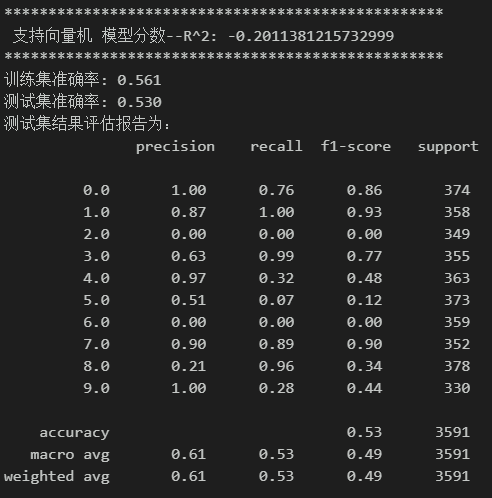
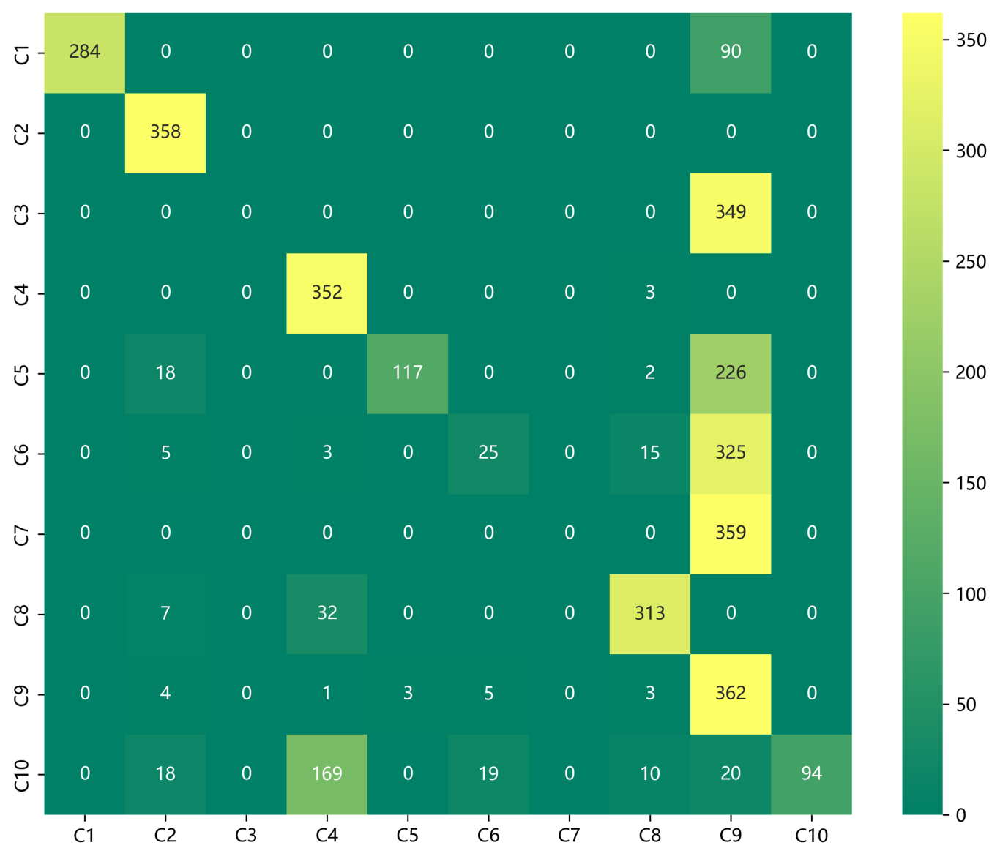
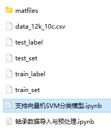

# Bearing Fault Diagnosis - SVM Fault Classification Model

The dataset includes a complete CWRU bearing fault dataset, as well as fault signal datasets, classification data, and label sets that have been generated. The corresponding code can be run.
It also includes preprocessing codes for the data and SVM classification codes.
Environment: Python 3.9, PyTorch 1.8 or above.
Fault classification confusion matrix:
Previously excellent content:
Python-Kaisi University (CWRU) Bearing Data Interpretation and Classification Processing
Python Bearing Fault Diagnosis (Part I): Short-time Fourier Transform STFT
Python Bearing Fault Diagnosis (Part II): Continuous Wavelet Transform CWT
Python Bearing Fault Diagnosis (Part III): Empirical Mode Decomposition EMD
Pytorch-LSTM Bearing Fault One-Dimensional Signal Classification (Part I)
Pytorch-CNN Bearing Fault One-Dimensional Signal Classification (Part II)
Pytorch-Transformer Bearing Fault One-Dimensional Signal Classification (Part III)
Python Bearing Fault Diagnosis (Part IV): Fault Classification Based on EMD-CNN
Python Bearing Fault Diagnosis (Part V): Fault Classification Based on EMD-LSTM
Python Bearing Fault Diagnosis (Part VI): Fault Classification Based on EMD-Transformer
Python Bearing Fault Diagnosis (Part VII): Fault Classification Based on EMD-CNN-LSTM
Python Bearing Fault Diagnosis (Part VIII): Fault Classification Based on EMD-CNN-GRU Parallel Model
Bearing Fault Identification Model based on FFT + CNN - BiGRU-Attention Attention Fusion of Time-Domain and Frequency-Domain Features
Bearing Fault Identification Model based on FFT + CNN - Transformer Attention Fusion of Time-Domain and Frequency-Domain Features
Python Bearing Fault Diagnosis (Part IX): Fault Classification Based on VMD+CNN-BiLSTM
Python Bearing Fault Diagnosis (10) - Fault Classification Based on VMD+CNN-Transformer
Python Bearing Fault Diagnosis (11) - Fault Classification Based on VMD+CNN-BiGRU-Attenion
Cross Attention Fusion of Time and Frequency Features with FFT + CNN-BiLSTM-CrossAttention Bearing Fault Identification Model
Cross Attention Fusion of Time and Frequency Features with FFT + CNN-Transformer-CrossAttention Bearing Fault Identification Model
Introduction to Python Bearing Fault Diagnosis
Python Bearing Fault Diagnosis (13) - Superstrong Machine Learning Recognition Model Based on Fault Signal Feature Extraction
Python Bearing Fault Diagnosis (14) - Highly Innovative Fault Recognition Model
Python Bearing Fault Diagnosis (15) - One-Dimensional Fault Signal Recognition Model Based on CNN-Transformer
Python Bearing Fault Diagnosis (16) - Highly Innovative Fault Recognition Model (II)
SCI 1 Region High Innovation Bearing Fault Diagnosis Model!
Python Bearing Fault Diagnosis (18) - Innovative Diagnosis Model Based on CNN-TCN-Attention
Highly Innovative Bearing Fault Diagnosis Model Based on GADF+Swin-CNN-GAM
Attention Magic Modification | Superstrong Bearing Fault Diagnosis Model!
End
\t2. Friends who like this can click the follow button, give the article a "like", share it in WeChat groups or discuss in groups.

## Images

<!-- PAYMENT_BLOCK -->

## Get this dataset

- Payment link (Stripe): [Buy now](https://buy.stripe.com/3cs8yP7sY87d0vu9AB)
- Payment QR code: 

<!-- /PAYMENT_BLOCK -->
